# Devil Summoner Translation Tools

Various tools for translating *Shin Megami Tensei: Devil Summoner*.

The repository includes a provisional AI English translation, along with a web toolkit for previewing wrap-widths and modifying lines.
Given another English AI translation has already been published, I'm adding releases to this repo as an alternative or supplemental resource for any future work on this game.


**If you're just looking to play the game**, there's a patch for the Sega Saturn Rev B version. Follow the [patching instructions](PATCHING.md), using the [latest release](https://github.com/coregee/devil_summoner_tools/releases).

## Status

| Target | State |
| --- | --- |
| Saturn game disc (Rev. B) | Feature complete, not extensively tested. |
| Saturn *Akuma Zensho* disc | Some early investigation, but non-functional and abandoned. |
| PSP | Early work; some functional surfaces, otherwise also abandoned. |

The tooling has been designed with the intention that changes made to one version will port cleanly to the other.

## Features

- Proportional (variable-width) text (intentionally excluding the battle terminal).
- Full-length names using appropriately-sized fonts across different surfaces
- Dictionary compression and split-paging support, to ensure the English script isn't space-compromised
- Revised profile input, for 8-character mixed-case English names
- Runtime-provided FMV subtitling
- Translated textures and title-screen logo

## Repository Overview

- **Readable SH-2 assembly** for every change to the game's code, with a small
  assembler that checks each patch against the original bytes before writing
  it. See [`saturn/engine/`](saturn/engine/README.md).
- **Documentation of how the game stores and draws text**: encodings, control
  codes, container formats, and the size limits of every screen. See
  [`saturn/text/`](saturn/text/README.md) and
  [`assets/consumers.md`](assets/consumers.md).
- **An extract/repack pipeline** that rebuilds the disc from the original plus
  the files in this repo, and verifies the result.
- **A browser-based translation editor** that previews lines in the game font
  and catches lines that won't fit. See [`tools/`](tools/README.md).
- **Language projects**: support for adding characters and importing fonts for
  other languages.

## AI Disclosure

This repository was developed with the assistance of AI tools. While I believe that current AI products are inflicting tremendous social, economic, and environmental harms, I also believe that, when used and deployed responsibly, the underlying technology has genuine potential and value for humanity, particularly in the fields of open-source software development, preservation, and accessibility. If you're dissatisfied with this, I encourage you to fork this repo, or otherwise create your own tools, translation, and/or documentation.

## Repository layout

| Directory | What's in it |
| --- | --- |
| `assets/text` | Editable JSON translation source texts. |
| `assets/image` | Replacement textures/artwork. |
| `assets/font` | Open-source typefaces used to generate the game fonts. |
| `saturn/` | Saturn extraction, text/font/graphics repacking, engine patches, and the disc build. |
| `psp/` | The partial PSP port, with the same general structure. |
| `tools/` | A local, browser-based translation editor. |

Each package has its own README with more detail.

## Building the Saturn version

### Requirements

- Python 3.10 or newer
- [Pillow](https://pypi.org/project/pillow/) (`python -m pip install Pillow`)
- Your own copies of the Saturn discs as BIN/CUE:
  - *Shin Megami Tensei: Devil Summoner* (Japan, Rev. B)
  - *Shin Megami Tensei: Devil Summoner - Akuma Zensho* (Japan)

The build currently expects both discs, even though the *Akuma Zensho* output
isn't usable.

### 1. Add the original discs

Put the untouched BIN/CUE files in
[`saturn/rom/original/`](saturn/rom/original/README.md). The expected filenames,
sizes and SHA-256 hashes are listed in
[`saturn/rom/discs.json`](saturn/rom/discs.json), and the build will refuse
anything that doesn't match.

Disc images (original or built) are ignored by Git. Don't commit or share them.

To extract and check the discs on their own:

```powershell
python -B saturn/rom/extract.py
python -B saturn/rom/extract.py --check
```

This writes the disc contents to `saturn/rom/extracted/`. The full build
re-extracts over that directory, so don't make edits there.

### 2. Build

```powershell
python -B saturn/build.py --plan    # show what will run
python -B saturn/build.py           # build
python -B saturn/build.py --check   # verify the outputs are up to date
```

The build regenerates fonts, text, engine patches and graphics, then rebuilds
both discs into:

```text
saturn/rom/build/game/
saturn/rom/build/compendium/
```

Use the image in `build/game/` with an emulator or real hardware.

To turn a build into a distributable BPS patch for Track 1 of the game disc:

```powershell
python -B saturn/rom/patch.py create --version 0.2.3
```

This writes `saturn/rom/patch/devil_summoner_en_v0.2.3.bps`, checks that it
reproduces the build exactly, and prints the CRC32 and SHA-256 of the original
and patched Track 1.

## Editing the translation

### Text

The translation lives in the `translation` fields of the JSON files under
[`assets/text/`](assets/text/README.md). Leave the `reference` (Japanese) text
and any tokens such as `{n}` alone; tokens stand in for things like button
icons or names that the game fills in. The files under `saturn/text/corpus/` are
raw extracted data, not something to edit.

Many screens have tight width or line limits. The build checks these and will
fail if a line doesn't fit. [`assets/consumers.md`](assets/consumers.md) and
[`saturn/text/README.md`](saturn/text/README.md) describe the limits for each
screen.

The translation editor is easier to work with than the raw JSON. It lets you
search the text, previews lines in the actual game font, and flags anything
that won't fit:

```powershell
python -B -m tools.editor
```

It's also available as **Open Translation Editor** in the VS Code launch
configurations. See [`tools/README.md`](tools/README.md).

### Images

Replacement art is in `assets/image/`. To replace a new image, extract the
originals, copy the one you want from `saturn/visual/extracted/<disc>/` into
`assets/image/`, and add an entry for it in the catalog and the Saturn
bindings:

```powershell
python -B saturn/visual/extract.py all
python -B saturn/visual/repack.py all
python -B saturn/visual/repack.py all --check
```

Don't hand-edit the files in `extracted/` or the hashes in the manifests.
[`saturn/visual/README.md`](saturn/visual/README.md) covers the supported image
formats and the awkward cases (stitched textures, palette-limited title art).

### Fonts and other languages

The source typefaces and their licenses are in
[`assets/font/`](assets/font/README.md). The per-disc font definitions in
`saturn/font/config/` decide which typeface goes where and how glyphs are
packed.

```powershell
python -B saturn/font/extract.py all
python -B saturn/font/repack.py all
python -B saturn/font/repack.py all --check
```

Translating into another language is possible, but swapping the typeface is
usually not enough on its own: you may also need to change character maps,
text encodings, and the patched text renderers. The editor can set up a new
language project and import a font for it; see
[`saturn/font/README.md`](saturn/font/README.md) and
[`assets/languages/README.md`](assets/languages/README.md).

## Tests

```powershell
python -m unittest discover -s saturn/font/tests -v
python -m unittest discover -s saturn/text/tests -v
python -m unittest discover -s saturn/engine/tests -v
python -m unittest discover -s saturn/visual/tests -v
python -m unittest discover -s psp/visual/tests -v
```

Some tests need the original discs in place. Without them you can still inspect
the build with `--plan`, `--list-steps` and `--list-profiles`.

## Documentation

- [Shared text assets](assets/text/README.md)
- [Translation style guide and glossary](assets/text/STYLE.md)
- [Shared image assets](assets/image/README.md)
- [Language projects](assets/languages/README.md)
- [Per-screen text limits](assets/consumers.md)
- [Saturn disc extraction and rebuilding](saturn/rom/README.md)
- [Saturn text](saturn/text/README.md)
- [Saturn engine patches](saturn/engine/README.md)
- [Saturn fonts](saturn/font/README.md)
- [Saturn graphics](saturn/visual/README.md)
- [PSP status](psp/README.md)
- [PSP graphics](psp/visual/README.md)

## License

Code and documentation written for this project are under the BSD Zero Clause
License. Text and images taken from the game, and the screenshots below, are
not covered by it, and the bundled fonts keep their own licenses. See
[LICENSE](LICENSE) for details.

## Screenshots

| **Title** | **Fusion Table** |
| :---: | :---: |
| 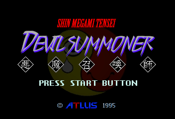 | 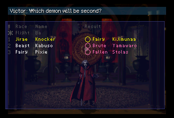 |
| **Equipment Screen** | **Event Choice** |
| 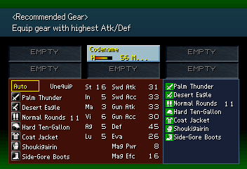 | 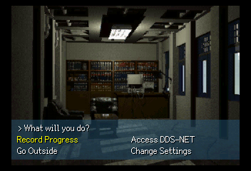 |
| **3D Field Event** | **Inventory** |
| 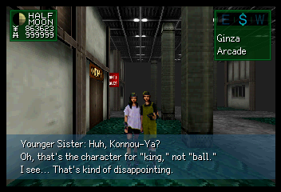 | 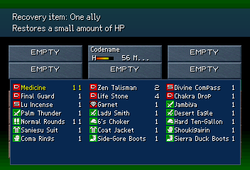 |
| **Negotiation Choice** | **Shop** |
| 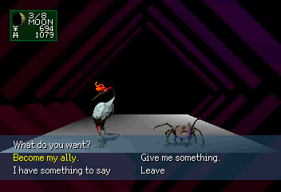 | 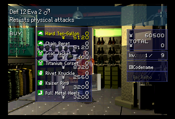 |
| **Settings** | **Status** |
| 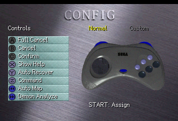 | 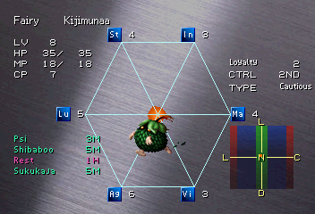 |
| **FMV Subtitles** | **Name Input** |
| 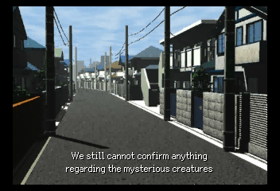 | 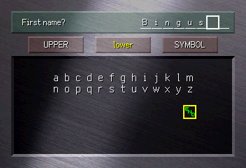 |
